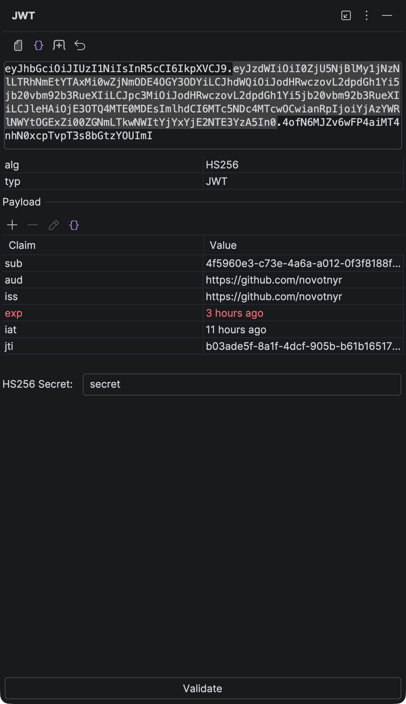
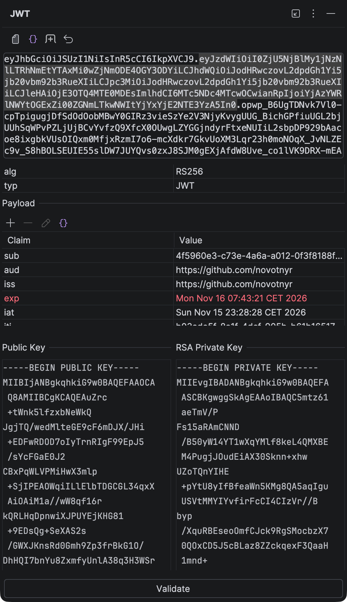

# JWT (JSON Web Token) Analyzer for IntelliJ IDEA

Inspect, verify, and edit JSON Web Tokens in a dedicated IntelliJ IDEA tool window.

[Get it on JetBrains Marketplace](https://plugins.jetbrains.com/plugin/9831-jwt-json-web-token-analyzer)

## What you can do

### Inspect a token

Paste a JWT into the tool window. The **Payload** tab shows decoded claims, and the **Header** tab shows every supplied header parameter. You can browse claims without supplying a secret or key. The encoded token highlights its payload segment, and malformed tokens show an error beside the input.

### Verify signatures and time claims

The plugin checks the optional `exp` and `nbf` time limits as soon as a token is parsed, without requiring a signing key. An expired token shows a warning above the tabs with its expiration time in the selected format, and the `exp` value is marked in the payload table. To check a signature, enter a shared secret for HS256 or HS384, or an RSA public key for RS256, then select **Validate**. The plugin also checks that `exp`, `nbf`, and `iat` contain numeric timestamps when present.

### Create and edit JWTs

Use **New JWT** to create an HS256, HS384, or RS256 token, with an optional `iat` claim. With a signing secret or RSA key pair available, use the payload table controls to add, edit, or remove claims. The plugin re-signs the token after each change and provides editors for strings, numbers, booleans, timestamps, and raw JSON.

### Work with timestamps

Choose **Timestamp format** in the JWT tool window's gear menu:

- **Unix timestamp** — Seconds since the Unix epoch.
- **ISO (UTC)** — ISO date and time in UTC (the default).
- **ISO (Local)** — ISO date and time in Java's default time zone, showing the offset in effect at the timestamp.
- **Medium Format** — Localized date and time using Java's default formatting locale and time zone.
  For example, with `sk-SK` and `Europe/Bratislava`, `2026-11-22T17:50:00Z` displays as `22. 11. 2026, 18:50:00`.
- **Relative** — Time relative to now, such as `2 hours ago`.

When editing a timestamp:

- Preview UTC and local time. 
- Use **Now**, **+15 min**, or **-15 min** to adjust the value.
- Fractional seconds are preserved while editing.

### Copy or open the payload

Copy the whole payload as formatted JSON, or open it in a JSON scratch file formatted with the IDE's code style. You can also right-click a claim to copy its value or a `name=value` pair.

### Configure RS256 keys

In **Settings/Preferences → Tools → JWT**, choose PEM files for default RS256 public and private keys. The plugin validates the files before saving and uses them to prefill the RS256 key fields. You can also paste keys directly, including text with escaped newlines (`\n`).

## Install

Open **Settings/Preferences → Plugins → Marketplace**, search for **JWT (JSON Web Token) Analyzer**, and select **Install**.

For a local ZIP, download it from [GitHub Releases](https://github.com/novotnyr/jwt-intellij-plugin/releases) and use **Install Plugin from Disk** in the Plugins settings.

## Get started

1. Open **View → Tool Windows → JWT** and paste a token into the text area.
2. Enter the matching secret or RS256 public key, then select **Validate** to check its signature and claims.
3. To edit and re-sign a token, provide its signing secret or RS256 key pair and use the controls above the payload table. Use **New JWT** to create a token from scratch.

## Screenshots

**HS256:** The tool window shows decoded claims and a shared secret field. The expired `exp` claim is highlighted in red.

**RS256:** The public key field is used to verify the signature. The private key field lets you edit claims and sign the updated token.

